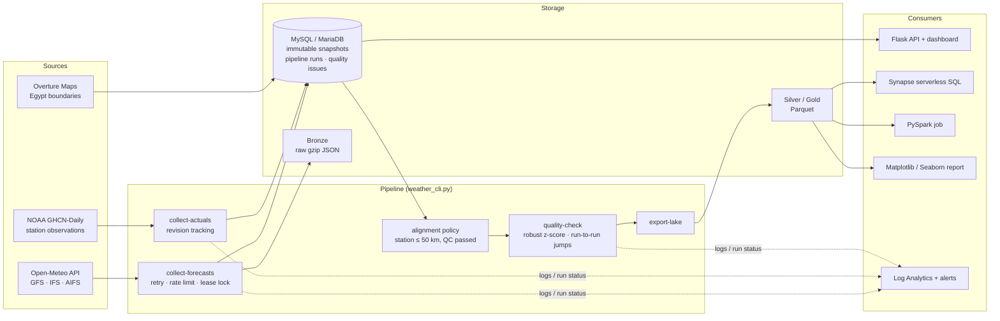

# Data Quality & Pipeline Observability Platform

### Weather Forecast Verification for Egypt

**A production-oriented Data Engineering graduation project | Digital Egypt Pioneers Initiative (DEPI) — Team 2**


---

## Overview

Weather providers revise their predictions continuously. If you compare *today's* forecast with what actually
happened, you get a misleading accuracy score, because the forecast that was really issued days earlier has been
overwritten. On top of that, real-world weather data arrives with missing values, mixed units, wrong
station/coordinate matches, API failures and silent revisions.

This platform solves that with a **reliable, observable data pipeline** that:

1. **Collects** daily forecasts (D+1 … D+10) from three explicitly identified global models —
   **NOAA GFS**, **ECMWF IFS** and **ECMWF AIFS** — for thousands of locations across Egypt.
2. **Preserves every forecast as an immutable snapshot**, so the prediction made 10, 5 or 1 day(s) ahead is never
   overwritten.
3. **Ingests measured station observations** (NOAA GHCN-Daily) and keeps every revision.
4. **Validates data quality** at every stage — schema/unit checks, plausibility rules, duplicate protection and
   statistical anomaly detection.
5. **Pairs forecasts with observations fairly** (same day, same lead time, eligible station within 50 km, QC passed)
   and computes **MAE, RMSE and bias** per model, lead time and governorate.
6. **Makes the pipeline observable** — every run, batch, retry, failure and quality issue is recorded and exposed
   through an API, a dashboard, log queries and alerts.
7. **Publishes a medallion data lake** (Bronze → Silver → Gold Parquet) for Synapse SQL, PySpark and reports.

> The project proposal and requirements are in
> [`docs/project-proposal-and-requirements.pdf`](docs/project-proposal-and-requirements.pdf).
> What was actually built versus what was proposed is tracked in
> [`docs/10-requirements-traceability.md`](docs/10-requirements-traceability.md).

---

## Architecture



Orchestration is provided two ways that call the **same idempotent CLI commands**:
**Apache Airflow** (`airflow/dags/depi_weather_daily`) and **Azure Container Apps Jobs** (production).

Full details: [`docs/01-architecture.md`](docs/01-architecture.md).

---

## Key Features

### Data quality
| Check | Where | Behaviour |
|---|---|---|
| Schema & unit validation | `weather/providers/open_meteo.py` | Rejects payloads that aren't °C, have mismatched array lengths or an incomplete D+1…D+10 horizon |
| Duplicate protection | Unique keys in `migrations/` | Re-running the same window inserts **0** rows (`INSERT IGNORE` / natural keys) |
| Plausibility & consistency | `weather/lake.py` (Silver) | −30…60 °C range, `Tmax ≥ Tmin`; invalid rows are flagged `is_valid = false`, not deleted |
| Cross-model outliers | `weather/quality.py` | Robust z-score (median / MAD) against the other models |
| Run-to-run jumps | `weather/quality.py` | Same model/point/target changes > 8 °C between consecutive runs |
| Observation QC | `weather/repository.py` | GHCN QC flags honoured; failed QC → `incompatible`, never used for scoring |
| Referential integrity | Foreign keys | Forecast → run → model → source; observation → station; match → station + point |

### Reliability
- Bounded retries with exponential backoff, explicit HTTP 429 handling and `Retry-After` support.
- Per-request throttling to stay inside the free Open-Meteo quota.
- **Lease-based locking** (`lock_key` + heartbeat + expiry) so two workers can never process the same model/day,
  and a crashed worker is recovered safely with `weather_cli.py recover --expired`.
- Batch-level checkpoints: a failed batch is isolated and recorded; the rest of the run continues (`partial` status).
- Raw responses archived content-addressed (SHA-256) for replay and audit.

### Observability
- `weather_pipeline_runs` / `weather_pipeline_batches`: status, counts (processed / inserted / duplicates / failed),
  attempts, errors, checkpoints.
- `weather_quality_issues`: every anomaly with severity, message and JSON details.
- `/api/pipeline/status`, `/api/pipeline/runs`, `/api/ready` endpoints + the dashboard's monitoring panel.
- Azure Log Analytics KQL queries and an e-mail alert on any job error (`monitoring/`).

---

## Tech Stack

| Layer | Technology |
|---|---|
| Language | Python 3.13 |
| Storage | MySQL 8 / MariaDB (spatial, SRID 4326), Azure Database for MySQL Flexible Server |
| Data processing | Pandas, NumPy, PyArrow (Parquet), PySpark |
| Orchestration | Apache Airflow DAG, Azure Container Apps Jobs (cron) |
| API / UI | Flask + Gunicorn, Chart.js dashboard (English / Arabic) |
| Data lake & analytics | Azure Data Lake Storage Gen2, Azure Synapse serverless SQL, Synapse Spark |
| Visualisation | Matplotlib, Seaborn |
| Monitoring | Azure Monitor / Log Analytics (KQL), scheduled-query alerts |
| DevOps | Docker, Azure Container Registry, GitHub Actions (CI + CD with OIDC) |
| Testing | pytest (25 tests) |

---

## Quick Start (local)

```powershell
# 1. Environment
py -m venv .venv
.\.venv\Scripts\Activate.ps1
pip install -r requirements.txt
Copy-Item .env.example .env          # set DB_USER / DB_PASSWORD

# 2. Database + geography
python weather_cli.py init-db
python scripts\import_geography.py --reset     # Egypt boundaries from Overture Maps

# 3. Pipeline
python weather_cli.py locations --sync
python weather_cli.py stations --discover
python weather_cli.py stations --match
python weather_cli.py collect-forecasts --limit 5
python weather_cli.py collect-actuals --limit 5
python weather_cli.py stations --align
python weather_cli.py quality-check
python weather_cli.py export-lake
python weather_cli.py report

# 4. Check & serve
python weather_cli.py validate
python -m pytest -q
python app.py                         # http://127.0.0.1:5000
```

Step-by-step guide: [`docs/08-local-setup.md`](docs/08-local-setup.md).
Azure deployment: [`docs/09-azure-deployment.md`](docs/09-azure-deployment.md).

---

## Repository Structure

```
├── app.py                      Flask API + dashboard entry point
├── weather_cli.py              Pipeline CLI (every job is a sub-command)
├── index.html                  Dashboard (Chart.js, English/Arabic)
├── weather/                    Weather pipeline package
│   ├── providers/open_meteo.py   Forecast adapter (explicit models, retries, rate limits)
│   ├── observations.py           NOAA GHCN-Daily station adapter
│   ├── repository.py             Database access, pipeline runs/leases, accuracy SQL
│   ├── quality.py                Statistical anomaly detection
│   ├── lake.py                   Bronze/Silver/Gold Parquet export
│   ├── archive.py                Raw-response archive (local or Azure Blob)
│   ├── analytics.py              MAE / RMSE / bias helpers
│   └── report.py                 Matplotlib/Seaborn charts
├── geo/                        Geography package (config, DB, reverse geocoding)
├── migrations/                 Versioned, idempotent SQL schema (001–004)
├── scripts/                    Geography import, migration, DB copy, Azure deploy, verification
├── airflow/dags/               Apache Airflow DAG
├── spark/                      PySpark accuracy job
├── synapse/                    Synapse serverless SQL views + analysis queries
├── monitoring/                 KQL queries + Azure Monitor alert script
├── tests/                      pytest suite
├── .github/workflows/          CI/CD pipeline
├── Dockerfile                  Runtime image (API + jobs)
└── docs/                       Detailed documentation
```

---

## Documentation

| # | Document | Contents |
|---|---|---|
| — | [Project proposal & requirements (PDF)](docs/project-proposal-and-requirements.pdf) | Original proposal, literature review, FR/NFR, acceptance tests |
| 01 | [Architecture](docs/01-architecture.md) | Components, data flow, design principles |
| 02 | [Data model](docs/02-data-model.md) | Every table, keys, provenance and immutability rules |
| 03 | [Pipeline & orchestration](docs/03-pipeline-and-orchestration.md) | CLI commands, run-batch flow, Airflow DAG, locking, retries |
| 04 | [Data quality](docs/04-data-quality.md) | All validation layers and anomaly detectors |
| 05 | [Observability & monitoring](docs/05-observability-and-monitoring.md) | Run tracking, health endpoints, KQL, alerts, recovery |
| 06 | [Data lake & analytics](docs/06-data-lake-and-analytics.md) | Medallion layout, accuracy metrics, Synapse, Spark, reports |
| 07 | [API & dashboard](docs/07-api-and-dashboard.md) | REST endpoints with examples |
| 08 | [Local setup](docs/08-local-setup.md) | Windows/XAMPP setup, geography import, configuration |
| 09 | [Azure deployment](docs/09-azure-deployment.md) | One-command deployment, jobs, CI/CD, cost & capacity |
| 10 | [Requirements traceability](docs/10-requirements-traceability.md) | Proposal requirements → implementation status |
| 11 | [Sources & coverage](docs/11-sources-and-coverage.md) | Providers, licensing, measured geographic coverage |
| AR | [نظرة عامة بالعربي](docs/ar/project-overview-ar.md) · [دليل Azure](docs/ar/azure-checklist-ar.md) | Arabic documentation |

---

## Project Team

| Member | Workstream |
|---|---|
| Habiba Mohamed Ahmed Ali | Forecast providers and observation connectors |
| Sameh Mohamed El-Araby Mohamed | ETL orchestration and API reliability |
| Fares Youssef Ali Youssef | Versioned database model and forecast verification |
| Mohamed Ramadan Fathy Mohamed | Monitoring, dashboards and alerts |
| Mahmoud Abdel-Sabour Bayoumi Sweilem | Travel scoring, testing and reporting |
| Alaa Ibrahim El-Saeed El-Hariry | Team coordination, research and documentation |

---

## Project Status

✅ **Core pipeline implemented, tested and deployable to Azure.**

- Implemented: forecast collection (3 models), immutable snapshots, station observations, alignment policy,
  data-quality checks, accuracy metrics, data lake, Airflow DAG, Spark/Synapse analytics, dashboard, monitoring,
  CI/CD.
- Accuracy results become meaningful as eligible station observations accumulate — forecasts are collected
  prospectively, so no back-tested numbers are claimed.
- Not yet implemented from the proposal: travel-season recommendations (Aswan report), Prometheus/Grafana
  (replaced by Azure Monitor), optional aviation module. See
  [requirements traceability](docs/10-requirements-traceability.md).

## Data Sources & Licensing

Forecasts: NOAA GFS and ECMWF IFS/AIFS via [Open-Meteo](https://open-meteo.com/en/terms) (free tier is
non-commercial). Observations: [NOAA NCEI GHCN-Daily](https://www.ncei.noaa.gov/products/land-based-station/global-historical-climatology-network-daily).
Boundaries: [Overture Maps Divisions](https://docs.overturemaps.org/) (ODbL / OpenStreetMap-derived).
See [`docs/11-sources-and-coverage.md`](docs/11-sources-and-coverage.md).

## Acknowledgment

Developed as part of the **Digital Egypt Pioneers Initiative (DEPI)** graduation requirements, applying Data
Engineering, workflow orchestration, data reliability and observability concepts to a practical,
production-oriented system.
