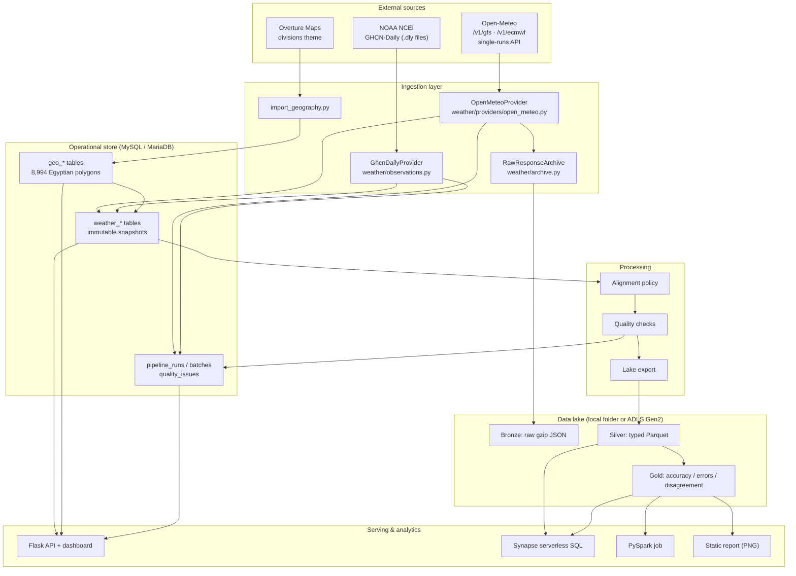
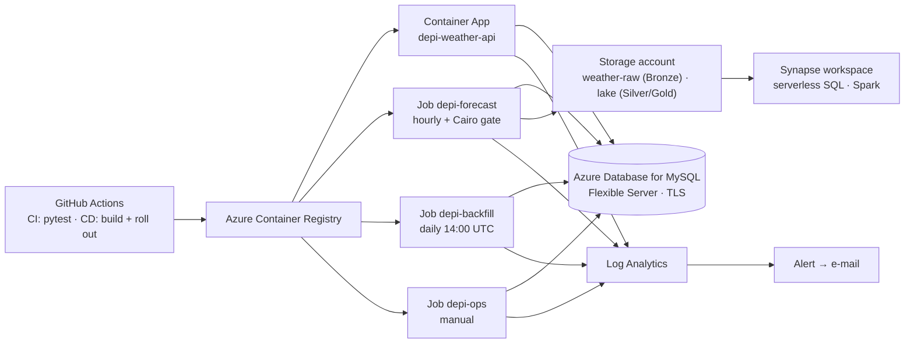

# 01 — Architecture

## 1. Goal

Build a small but production-oriented platform that can answer, **honestly and reproducibly**:

> *"For this place in Egypt, how accurate was each weather model's forecast made N days ahead?"*

"Honestly" means the platform must never:

- overwrite a forecast with a newer one (that would hide the real lead-time error),
- treat a model estimate or reanalysis as ground truth,
- compare a forecast with a station that is too far away or failed quality control,
- silently drop failures or duplicate data on retry.

The architecture is designed around those rules.

## 2. High-level components

## 3. Layers explained

### 3.1 Geography layer (`geo/`, `scripts/import_geography.py`)

Every forecast must be attached to a real place. The project imports **Overture Maps** administrative polygons for
Egypt (country → governorate → district → city → neighbourhood; 8,994 polygons) into spatial MySQL tables
(SRID 4326 with a spatial index).

- Each polygon stores a **representative interior point**. `weather_cli.py locations --sync` turns those into
  deduplicated **sampling points** — the coordinates actually sent to the forecast API.
- `/api/reverse` performs database-native reverse geocoding (`bbox prefilter + ST_Intersects`), so the dashboard can
  search any Arabic or English place name.

### 3.2 Ingestion layer (`weather/providers`, `weather/observations.py`)

| Adapter | Source | Notes |
|---|---|---|
| `OpenMeteoProvider` | Open-Meteo forecast API | Explicit model identifiers only (`gfs_global`, `ecmwf_ifs`, `ecmwf_aifs025_single`) — never "Best Match". Multi-coordinate batch requests, throttling, retries, 429 handling, unit and horizon validation. Supports the Single Runs API for archived model runs. |
| `GhcnDailyProvider` | NOAA GHCN-Daily | Discovers Egyptian stations with TMAX/TMIN inventory, parses fixed-width `.dly` files (tenths of °C), keeps QC/measurement/source flags. |
| `RawResponseArchive` | — | Gzip + SHA-256 content-addressed archive of every raw response (local `raw-weather/` or Azure Blob). This is the **Bronze** layer. |

### 3.3 Operational store (`migrations/`)

A normalized relational model (see [02 — Data model](02-data-model.md)) with natural unique keys that make every
write **idempotent**. The same database holds the operational metadata (pipeline runs, batches, quality issues),
so data and its lineage live together.

### 3.4 Processing

1. **Alignment policy** — decides which station/point pairs and which observations are eligible for scoring.
2. **Quality checks** — statistical anomaly detection written to `weather_quality_issues`.
3. **Lake export** — Silver and Gold Parquet tables, partitioned by issue date / observation month.

### 3.5 Serving & analytics

- **Flask API + dashboard** for interactive exploration (forecast evolution D−10 → D−1, actual vs forecast,
  accuracy metrics, pipeline health).
- **Azure Synapse serverless SQL** views directly over Parquet.
- **PySpark** job that recomputes Gold accuracy and the best model per governorate at scale.
- **Matplotlib/Seaborn** report for collection volume, MAE by lead and model disagreement.

### 3.6 Orchestration

The pipeline is a set of **idempotent CLI commands** (`weather_cli.py`). Any scheduler can run them:

- **Apache Airflow** DAG (`airflow/dags/depi_weather_dag.py`) — daily at 09:00 Africa/Cairo.
- **Azure Container Apps Jobs** — production; an hourly trigger plus a Cairo-time gate inside `run-batch` (handles
  daylight-saving changes without a fixed UTC offset).

See [03 — Pipeline & orchestration](03-pipeline-and-orchestration.md).

## 4. Design principles

| Principle | How it is enforced |
|---|---|
| **Immutability** | A forecast row is keyed by `(model, source_run_key, sampling_point, target_date)`; a newer run creates new rows and never updates old ones. |
| **Idempotency** | Natural unique keys + `INSERT IGNORE` / `ON DUPLICATE KEY`; replaying a day inserts 0 rows. Lake partitions are rewritten whole. |
| **Provenance** | Every forecast links to its run, request hash, raw archive URI and SHA-256; every model records its originating organization *and* its distributor. |
| **Ground truth is measured** | Only station observations are "actual". Missing observations remain missing — never filled from models. |
| **Fair comparison** | Same target day, explicit lead (1–10), station ≤ 50 km, QC passed; temperature in °C; calendar days in Africa/Cairo, timestamps in UTC. |
| **Fail visibly** | Every run/batch has a status (`succeeded`, `partial`, `failed`, `cancelled`) and an error message; anomalies are stored, never silently dropped. |
| **Same code everywhere** | One Docker image serves the API (`gunicorn app:app`) and every job (`python weather_cli.py …`). |
| **Secrets outside Git** | `.env` (local) and Container Apps secrets (Azure); `.env.example` documents the variables. |

## 5. Deployment view (Azure)

Details: [09 — Azure deployment](09-azure-deployment.md).
