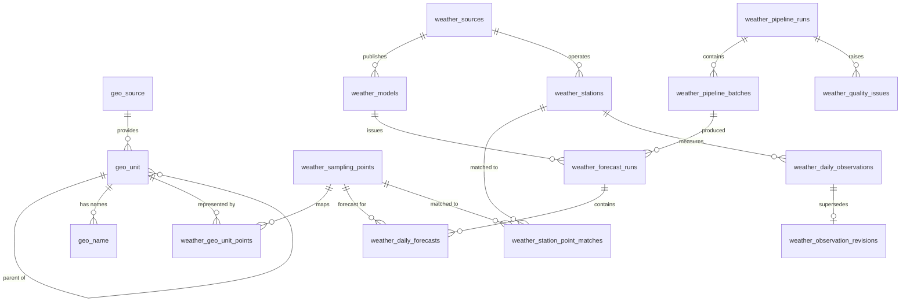

# 02 — Data Model

All tables are created by versioned, idempotent SQL migrations in [`migrations/`](../migrations) and applied with
`python weather_cli.py init-db` (or `python scripts/migrate.py`). The migration runner translates MariaDB-only syntax
(`ADD COLUMN IF NOT EXISTS`, `CREATE INDEX IF NOT EXISTS`) into checks that also work on **MySQL 8**, so the same files
run locally (XAMPP/MariaDB) and on Azure Database for MySQL.

| Migration | Purpose |
|---|---|
| `001_geography.sql` | Geography source, import job, polygon and multilingual-name tables |
| `002_overture_hierarchy.sql` | Overture division id for source-native parent links |
| `003_weather_phase2.sql` | Weather sources, models, sampling points, stations, forecasts, observations, pipeline runs, quality issues + seed data |
| `004_pipeline_resilience.sql` | Execution leases (heartbeat, expiry, worker token) and the immutable snapshot key on forecasts |

## 1. Entity-relationship overview

## 2. Geography tables

| Table | Role | Key fields |
|---|---|---|
| `geo_source` | Data source + release (e.g. Overture `2026-10-21.0`), licence, attribution | `UNIQUE(slug, release_version)` |
| `geo_import_job` | Resumable import checkpoints and status | `status`, `checkpoint_feature` |
| `geo_unit` | One administrative polygon | `UNIQUE(source_id, source_feature_id)`, `parent_id`, `admin_level`, `name`, `name_local`, bbox columns, `geometry` (SRID 4326, `SPATIAL KEY`), `geometry_sha256` |
| `geo_name` | Language/script-aware names (Arabic, English, aliases) | `UNIQUE(unit_id, language_code, name_kind, name)` |

Conventions: longitude is X and latitude is Y (`POINT(lon lat)`); MySQL 8 is told `axis-order=long-lat` explicitly.
`parent_relation_method` records *how* a parent link was established (`source` hierarchy or `spatial_containment`).

## 3. Weather reference tables

| Table | Role |
|---|---|
| `weather_sources` | Who distributes the data and under which terms: `open_meteo_gfs`, `open_meteo_ecmwf`, `noaa_ghcn_daily`. Stores **organization** and **distributor** separately (Open-Meteo is never recorded as the meteorological origin). |
| `weather_models` | Exact model identity: `gfs_global` (NOAA, ~13 km), `ecmwf_ifs` (ECMWF IFS HRES, ~9 km), `ecmwf_aifs025_single` (ECMWF AIFS 0.25°, ~28 km), with horizon and run frequency. |
| `weather_sampling_points` | Deduplicated coordinates sent to the forecast API. `UNIQUE(latitude, longitude, point_method)`; flags `forecast_coverage` / `observation_coverage`. |
| `weather_geo_unit_points` | Maps every polygon to its representative sampling point (`role = primary`). |
| `weather_stations` | GHCN-Daily stations in Egypt with TMAX/TMIN availability, first/last observation dates, elevation. |
| `weather_station_point_matches` | Nearest station for each sampling point: `distance_km`, `elevation_difference_m`, `suitability_score`, `is_primary`, and **`temporal_alignment`** (`verified` / `compatible` / `uncertain` / `incompatible`). |

## 4. Fact tables

### 4.1 `weather_forecast_runs`

One row per *(model, logical run, request)*. Records `run_kind` (`live_latest`, `specific_run`, `archived_run`),
`initialization_at_utc` (only when truly known — collection time is never passed off as initialization time),
`collected_at_utc`, `request_hash`, `response_archive_uri` and `response_sha256`.

`UNIQUE(model_id, source_run_key, request_hash)`.

### 4.2 `weather_daily_forecasts` — the immutable snapshot

| Column | Meaning |
|---|---|
| `forecast_run_id`, `model_id`, `source_run_key` | Which run produced the value |
| `sampling_point_id` | Where |
| `target_date` | The calendar day being forecast (Africa/Cairo) |
| `lead_days` | 1…10 — how many days ahead it was issued (`CHECK lead_days BETWEEN 0 AND 10`) |
| `temperature_max_c`, `temperature_min_c` | Forecast values, °C, `DECIMAL(6,2)` |
| `requested_latitude/longitude`, `model_grid_latitude/longitude` | Requested point vs. the model grid cell actually returned |
| `quality_status` | `valid`, `partial`, `unavailable`, `rejected` |

**Snapshot key:** `UNIQUE(model_id, source_run_key, sampling_point_id, target_date)`.
Tomorrow's run for the same target date has a different `source_run_key`, so it becomes a *new* row with a smaller
`lead_days`. This is what allows the dashboard to show how a forecast for one day evolved from D−10 to D−1.

### 4.3 `weather_daily_observations` and `weather_observation_revisions`

Measured station values only. Each row has a `source_revision_key` (SHA-256 of the values + QC flags) and
`is_current`. If NOAA later corrects a value, the old row is kept with `is_current = false`, a new row is inserted
and the link is stored in `weather_observation_revisions`. Nothing is overwritten.

`UNIQUE(station_id, observation_date, source_revision_key)`.

## 5. Operational / observability tables

| Table | Role |
|---|---|
| `weather_pipeline_runs` | One row per job execution: `job_type`, `logical_date`, `status` (`running`, `succeeded`, `partial`, `failed`, `cancelled`), timings, processed/inserted/duplicate/failed counts, `error_message`, plus the **lease** columns `lock_key` (unique), `worker_token`, `heartbeat_at_utc`, `lease_expires_at_utc`. |
| `weather_pipeline_batches` | One row per batch inside a run: `batch_key`, `status`, `attempt_count`, counts, `checkpoint_json` (e.g. `next_offset` / `retry_offset`), error. |
| `weather_quality_issues` | Every detected issue: `entity_type`, `entity_id`, `issue_code`, `severity` (`info`/`warning`/`error`/`critical`), `message`, `details_json`, `resolved_at_utc`. |

## 6. Uniqueness and idempotency summary

| Data | Natural key | Replay result |
|---|---|---|
| Polygon | `(source_id, source_feature_id)` | Update in place if geometry changed, else no-op |
| Sampling point | `(latitude, longitude, point_method)` | Reused |
| Forecast run | `(model_id, source_run_key, request_hash)` | Reused |
| Daily forecast | `(model_id, source_run_key, sampling_point_id, target_date)` | Counted as duplicate, not inserted |
| Observation | `(station_id, observation_date, source_revision_key)` | Duplicate if unchanged; new revision if changed |
| Pipeline run | `lock_key` (while running) | Second concurrent worker is refused |
| Pipeline batch | `(pipeline_run_id, batch_key)` | Attempt counter incremented |

## 7. Capacity notes

Upper bound: `points × models × 10 leads × 365 days`. With all 8,994 polygons and 3 models this is ~98.5 M forecast
rows/year, which is why `WEATHER_MAX_LOCATIONS` (default 1,500 on Azure) caps the number of sampling points and
collection is ordered by administrative priority (governorates → districts → cities → neighbourhoods).
