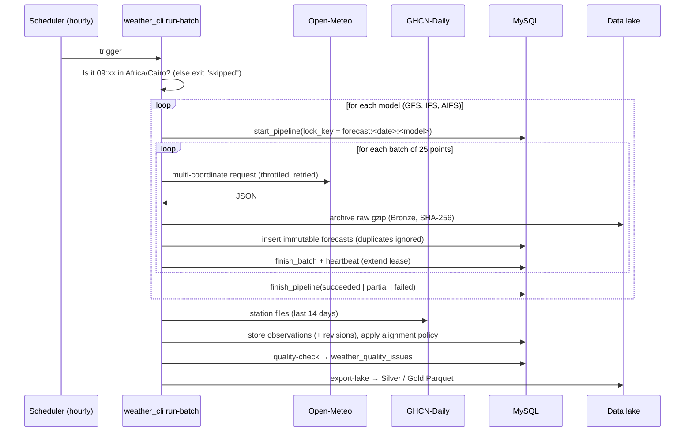
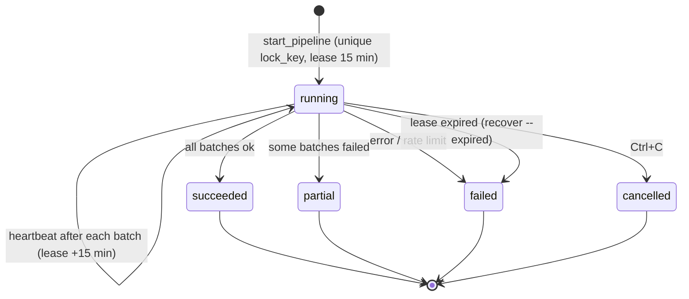
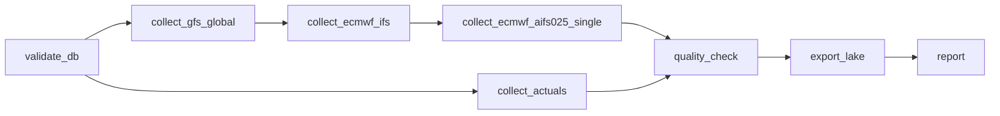

# 03 — Pipeline & Orchestration

The whole pipeline is exposed as sub-commands of a single CLI, [`weather_cli.py`](../weather_cli.py). Every command
prints one JSON line (easy to parse in logs) and returns a meaningful exit code, so it can be scheduled by Airflow,
Azure Container Apps Jobs, cron or by hand.

## 1. Commands

| Command | What it does |
|---|---|
| `init-db` | Applies all migrations (idempotent). |
| `locations --sync` / `--status` | Creates sampling points from polygon representative points / shows coverage. |
| `stations --discover` | Downloads the GHCN-Daily inventory and stores Egyptian stations with TMAX/TMIN. |
| `stations --match [--maximum-distance-km 250]` | Records the nearest station for every sampling point (context only, not yet eligible). |
| `stations --align` | Applies the comparison eligibility policy (see §4). |
| `collect-forecasts` | Collects D+1…D+10 for every model and point. Options: `--model`, `--date`, `--run` (archived run, ISO UTC), `--location-id`, `--batch-size`, `--limit`, `--dry-run`. |
| `collect-actuals [--lookback-days 14]` | Collects station observations for the last N days, then applies the alignment policy. |
| `backfill-actuals [--lookback-days 45]` | Same as above with a longer window (catches late NOAA corrections). |
| `quality-check [--days 3]` | Runs the statistical anomaly detectors. |
| `export-lake [--days 30]` | Writes Silver and Gold Parquet layers. |
| `report` | Renders PNG charts from the Gold layer into `reports/<date>/`. |
| `validate` | Health report; exit code 1 if there are unmapped units, running/expired runs or open quality errors. |
| `analyze` | Counts eligible forecast/observation comparisons. |
| `status` | Pipeline summary (records, runs by status). |
| `recover --expired` / `--run-id N` | Releases expired execution leases / one confirmed orphaned run. |
| `run-batch [--force]` | The scheduled end-to-end job (see §2). |

Exit codes: `0` success, `1` partial/failed, `2` nothing to do (e.g. no locations), `75` rate-limited
(retry later), `130` cancelled by operator.

In containers the command can also be passed via the `DEPI_COMMAND` environment variable
(e.g. `DEPI_COMMAND="collect-forecasts --limit 5"`), which avoids quoting issues in `az containerapp job`.

## 2. The daily batch (`run-batch`)

**Why an hourly trigger with a Cairo-time gate?** Container Apps cron runs in UTC, while Egypt observes daylight
saving time. A fixed UTC cron would drift by an hour twice a year. The job therefore runs every hour and only does
work during the 09:00 Africa/Cairo hour; `--force` bypasses the gate for manual runs.

## 3. Reliability mechanisms

### 3.1 Retries and rate limiting (`OpenMeteoProvider._request`)

- Minimum interval between requests (`WEATHER_REQUEST_INTERVAL`, default 3 s).
- HTTP 5xx and network errors → retried with exponential backoff (1, 2, 4… max 8 s).
- HTTP 429 → waits for `Retry-After` (or `WEATHER_RATE_LIMIT_BACKOFF × attempt`); if still limited, raises
  `RateLimitError`, the run is closed cleanly and the CLI exits with `75` so the scheduler retries later.
- Points are sent in multi-coordinate batches (`WEATHER_BATCH_SIZE`, default 25) to minimise calls.

### 3.2 Response validation

A response is rejected (batch marked `failed`, nothing stored) if:
- the number of location results differs from the number requested,
- units are not `°C`,
- daily arrays have inconsistent lengths,
- the D+1…D+10 horizon is incomplete.

### 3.3 Execution leases (no double processing)

- `lock_key` is unique while a run is active, so a second worker for the same model/day is refused.
- A worker that crashes stops heart-beating; after the lease expires the next start (or `recover --expired`) marks
  it `failed` and releases the lock — the retry is safe because all writes are idempotent.
- `heartbeat_pipeline` fails if the run no longer owns the lease, preventing a "zombie" worker from continuing.

### 3.4 Batch isolation and checkpoints

Each batch is a row in `weather_pipeline_batches` with its own status, attempt count and checkpoint
(`next_offset` / `retry_offset`). One failed batch does not stop the others; the run ends as `partial`.

## 4. Station alignment policy

Observations are only used for scoring when both conditions hold:

| Rule | Implementation |
|---|---|
| Station/point distance ≤ `WEATHER_ALIGNMENT_DISTANCE_KM` (50 km) | `weather_station_point_matches.temporal_alignment = compatible`, otherwise `incompatible` |
| GHCN QC flag blank (passed QC) for TMAX and TMIN | `weather_daily_observations.temporal_alignment = compatible`, otherwise `incompatible` |

Policy version string: `policy-v1: GHCN-Daily date = Africa/Cairo calendar day; QC flag blank; station <= 50 km`.
Rows an operator has set to `verified` are never changed by the automatic policy.

## 5. Apache Airflow DAG

File: [`airflow/dags/depi_weather_dag.py`](../airflow/dags/depi_weather_dag.py) — DAG id `depi_weather_daily`.

| Setting | Value |
|---|---|
| Schedule | `0 9 * * *` in `Africa/Cairo` (DST handled by the timezone) |
| Retries | 2, 10-minute delay, exponential backoff |
| `max_active_runs` | 1 |
| `catchup` | False |
| Forecast task timeout | 2 hours |

The three model tasks run **sequentially** because they share one provider rate limit — parallel calls would cause
HTTP 429. Each task calls the same idempotent CLI command, so Airflow retries never duplicate data.

To use it, mount `airflow/dags/` into `$AIRFLOW_HOME/dags` and set `DEPI_HOME` to the project folder.

## 6. Azure Container Apps Jobs (production)

| Job | Trigger | Command |
|---|---|---|
| `depi-forecast` | Cron `0 * * * *` (hourly, Cairo gate inside) | `weather_cli.py run-batch` |
| `depi-backfill` | Cron `0 14 * * *` | `weather_cli.py backfill-actuals` |
| `depi-ops` | Manual | Any command via `DEPI_COMMAND` (migrations, imports, recovery) |

All jobs use `--parallelism 1`, `--replica-retry-limit 1` and the same Docker image as the API. See
[09 — Azure deployment](09-azure-deployment.md).
