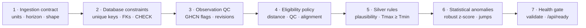

# 04 — Data Quality

Data quality is enforced in **layers**: each stage catches a different class of problem, and nothing bad is silently
deleted — it is either rejected with a recorded reason, flagged, or stored as an issue for review.



## 1. Ingestion contract (forecasts)

Implemented in `OpenMeteoProvider._parse` and `fetch` ([`weather/providers/open_meteo.py`](../weather/providers/open_meteo.py)).

| Check | Failure behaviour |
|---|---|
| Number of location results equals number of points requested | `ProviderError` → batch `failed`, nothing stored |
| `daily_units` for Tmax/Tmin are exactly `°C` | Rejected (prevents mixed units) |
| `time`, `temperature_2m_max`, `temperature_2m_min` arrays have equal length | Rejected |
| Lead days 1…10 all present | Rejected (`did not return the complete D+1..D+10 horizon`) |
| Explicit model identifier only | Unknown model → `ValueError`; "Best Match"/seamless models are never requested |
| Null value for one day | Stored with `quality_status = 'unavailable'` (not invented) |

## 2. Database constraints

- **Uniqueness** — natural keys on every fact table (see [02 — Data model §6](02-data-model.md#6-uniqueness-and-idempotency-summary)):
  duplicates are counted (`duplicate_count`) instead of inserted.
- **Referential integrity** — foreign keys from forecasts → runs → models → sources, observations → stations,
  matches → stations + points, batches → runs, quality issues → runs.
- **Domain constraints** — `CHECK (lead_days BETWEEN 0 AND 10)`, `ENUM` statuses, `DECIMAL(6,2)` temperatures,
  SRID 4326 geometry.

## 3. Observation quality (GHCN-Daily)

Implemented in [`weather/observations.py`](../weather/observations.py) and `WeatherRepository.store_observations`.

- Values are converted from tenths of °C; the missing sentinel `-9999` stays `NULL`.
- Measurement, quality and source flags are preserved per element: `M=…;Q=…;S=…|M=…;Q=…;S=…` (TMAX | TMIN).
- Each observation carries a SHA-256 **revision key**. If NOAA later changes a value, the previous row is retained
  (`is_current = false`) and linked in `weather_observation_revisions` — corrections are auditable.

## 4. Comparison eligibility

A forecast is only scored against an observation when **all** of these hold (`apply_alignment_policy`):

1. The primary station for that sampling point is within **50 km** (`WEATHER_ALIGNMENT_DISTANCE_KM`).
2. Both TMAX and TMIN passed GHCN QC (blank `Q` flag).
3. Same calendar day (target date = observation date, Africa/Cairo) and the forecast has an explicit lead.
4. Neither value is `NULL`.

Everything else is marked `incompatible` (or stays `uncertain`) and is **excluded** from MAE/RMSE/bias — but still
counted, so coverage is visible.

## 5. Silver-layer rules

Implemented in `clean_forecasts` ([`weather/lake.py`](../weather/lake.py)):

| Rule | Result |
|---|---|
| Columns coerced to proper types (`float64`, `date`, `int16`) | Non-numeric → `NaN` |
| Physical plausibility: −30 °C ≤ T ≤ 60 °C for Egypt | `is_valid = false` |
| Consistency: `Tmax ≥ Tmin` | `is_valid = false` |
| Derived `issue_date = target_date − lead_days` | Used for partitioning and run-to-run analysis |

Invalid rows remain in Silver (with `is_valid = false`) for audit, and are excluded from Gold. The export reports
`invalid_forecast_rows` in its JSON output.

## 6. Statistical anomaly detection

Implemented in [`weather/quality.py`](../weather/quality.py), run by `weather_cli.py quality-check` (and inside
`run-batch`). Findings are written to `weather_quality_issues` with severity `warning` — they never block the
pipeline and are never deleted. Each finding is stored once (deduplicated by entity + issue code).

### 6.1 Cross-model outlier (`cross_model_outlier`)

For each `(sampling_point, target_date, lead_days)` with ≥ 3 models:

```
median   = median(Tmax over models)
abs_dev  = |Tmax_model − median|
MAD      = median(abs_dev) × 1.4826          # comparable to a standard deviation
scale    = max(MAD, 3.0 °C / 3.5)            # physical floor: MAD is often ~0 with three models
z        = abs_dev / scale
flag if  z > 3.5  and  abs_dev ≥ 3.0 °C
```

The median/MAD ("robust z-score") is used instead of mean/standard deviation because a single bad value cannot drag
the reference with it.

### 6.2 Run-to-run jump (`run_to_run_jump`)

For the same model, point and target date, consecutive runs (lead N+1 → lead N) should evolve smoothly.
A change of **more than 8 °C** between consecutive runs is flagged — it usually indicates a corrupt payload or a
grid-cell problem.

Example stored issue:

```json
{
  "entity_type": "weather_daily_forecast",
  "issue_code": "run_to_run_jump",
  "severity": "warning",
  "message": "gfs_global Tmax changed 9.4C between consecutive runs",
  "details_json": {"previous_c": 31.2, "current_c": 40.6}
}
```

## 7. Health gate

`weather_cli.py validate` and `GET /api/ready` return **not ready** (exit code 1 / HTTP 503) when any of these is
non-zero:

- unmapped geographic units,
- running pipelines (CLI only) or **expired leases**,
- open quality issues with severity `error` or `critical`.

## 8. Tests covering data quality

| Test | Verifies |
|---|---|
| `test_open_meteo_parser_keeps_only_d1_through_d10` | Only D+1…D+10 retained |
| `test_open_meteo_parser_rejects_short_horizon_and_wrong_units` | Horizon and unit contract |
| `test_ghcn_parser_converts_tenths_and_preserves_missing` | Unit conversion, missing values stay `NULL` |
| `test_clean_forecasts_derives_issue_date_and_flags_invalid_rows` | Silver plausibility rules |
| `test_errors_and_accuracy_use_only_eligible_observations` | Ineligible observations excluded from scoring |
| `test_robust_outlier_and_jump_detection` | Both anomaly detectors |
| `test_accuracy_metrics_and_common_samples` | Paired-sample metrics |
| `test_raw_archive_is_content_addressed_and_compressed` | Bronze integrity |
| `test_rate_limit_exposes_retry_after_without_hammering` | Rate-limit behaviour |
