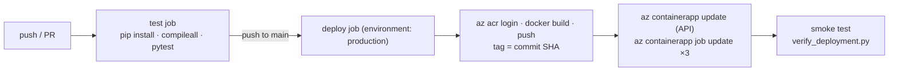

# 09 — Azure Deployment

The API and every scheduled job run from **one Docker image** with different commands. The HTTP app never starts a
scheduler or performs collection inside a request.

> Arabic step-by-step checklist: [`ar/azure-checklist-ar.md`](ar/azure-checklist-ar.md)

## 1. Resources

| Resource | Name (default) | Purpose |
|---|---|---|
| Resource group | `rg-depi-weather` (region `uaenorth`) | Everything below |
| Azure Container Registry | `depiweather…` (Basic) | Docker image `depi-weather:<tag>` |
| Azure Database for MySQL Flexible Server | `depi-mysql-*` (Burstable B1ms, MySQL 8, TLS) | Operational database `depi` |
| Storage account (ADLS Gen2) | `depilake*` | Containers `weather-raw` (Bronze) and `lake` (Silver/Gold) |
| Log Analytics workspace | `depi-logs` (30-day retention) | App and job logs |
| Container Apps environment | `depi-env` (Workload Profiles / Consumption) | Hosts the app and jobs |
| Container App | `depi-weather-api` | Dashboard + REST API (Gunicorn, scales to zero) |
| Container Apps Job | `depi-forecast` | Hourly; collects at 09:00 Africa/Cairo (`run-batch`) |
| Container Apps Job | `depi-backfill` | Daily 14:00 UTC (`backfill-actuals`) |
| Container Apps Job | `depi-ops` | Manual; init, validation, one-off commands via `DEPI_COMMAND` |
| User-assigned identity | `depi-pull-identity` | `AcrPull` for image pulls (no registry passwords) |
| Synapse workspace (optional) | `depi-syn-*` | Serverless SQL over the lake |
| Action group + alert (optional) | `depi-alerts`, `depi-job-errors` | E-mail on job errors |

## 2. One-command deployment

[`scripts/deploy_azure.ps1`](../scripts/deploy_azure.ps1) is **re-runnable**: it creates what is missing and
reuses what exists.

```powershell
az login
powershell -ExecutionPolicy Bypass -File .\scripts\preflight.ps1
powershell -ExecutionPolicy Bypass -File .\scripts\deploy_azure.ps1 -WithSynapse -AlertEmail you@example.com
```

| Parameter | Default | Meaning |
|---|---|---|
| `-ResourceGroup` | `rg-depi-weather` | Target resource group |
| `-Location` | `uaenorth` | Azure region |
| `-Tag` | current Git commit (short SHA) | Image tag; an existing tag is reused, not rebuilt |
| `-MaxLocations` | `1500` | `WEATHER_MAX_LOCATIONS` (keeps the free API tier under its limits) |
| `-OpenMeteoApiKey` | empty | Optional customer API key |
| `-WithSynapse` | off | Also create a Synapse workspace |
| `-AlertEmail` | empty | Create the e-mail alert |
| `-SkipDataCopy` / `-SkipFirstRun` | off | Skip the DB copy / the first full collection |

Steps performed:

1. **Local checks** — tests and local database.
2. **Resource providers** registered (one-time).
3. **Container registry + image** — `az acr build` (or local Docker + push via `scripts/build_push_acr.ps1`).
4. **Data lake storage** — ADLS Gen2 account and containers.
5. **Azure MySQL** — server, firewall rules, database.
6. **Database copy** — `scripts/copy_database.py` copies the local MariaDB schema and data to Azure MySQL 8,
   converting geometry axis order and verifying row counts.
7. **Log Analytics + Container Apps environment** (Workload Profiles mode).
8. **API** `depi-weather-api` with secrets and environment variables.
9. **Jobs** with a user-assigned identity that already has `AcrPull`.
10. **Cloud verification** — `init-db`, `validate`, two `collect-forecasts --limit 5` runs (the second must insert 0
    — idempotency proof), then `scripts/verify_deployment.py https://<fqdn>`.
11. **First full collection** — `run-batch --force`.
12. **Synapse** (optional) and **alerts** (optional).

Generated names and passwords are stored in `.azure/deploy-state.json` (git-ignored — keep it private).

## 3. Secrets

- Never in the image, Git, templates or command history.
- Stored as Container Apps **secrets** (`secretref:`): database password, storage connection string, optional API
  key.
- Registry pulls use managed identity; CI/CD uses **OIDC federated credentials** (no stored Azure password).

## 4. Scheduling and Cairo DST

Container Apps cron is UTC and Egypt observes daylight saving time. The forecast job runs **hourly** and
`run-batch` only does work during the 09:00 Africa/Cairo hour, so no cron change is needed at DST boundaries.
Execution leases guarantee one active run per model/day even if triggers overlap.

## 5. CI/CD (GitHub Actions)

[`.github/workflows/ci-cd.yml`](../.github/workflows/ci-cd.yml)



Setup: create an app registration with a federated credential for this repository, grant it `Contributor` on the
resource group and `AcrPush` on the registry, then add repository secrets `AZURE_CLIENT_ID`, `AZURE_TENANT_ID`,
`AZURE_SUBSCRIPTION_ID`, and create a `production` environment.

## 6. Database migration safety

1. Back up first: `mysqldump --single-transaction --routines --triggers --default-character-set=utf8mb4 depi > depi.sql`
   (dumps are git-ignored).
2. Record checks: `SELECT COUNT(*) FROM geo_unit`, counts by `admin_level`, orphan parents, Arabic-name samples,
   geometry validity samples.
3. Use `utf8mb4`, require TLS (`DB_SSL_CA`, `DB_SSL_VERIFY_CERT=true`), least-privilege application account.
4. `python weather_cli.py init-db` is additive — it never drops geography tables.
5. Compare counts and run API health checks before enabling scheduled jobs.
6. Use Azure automated backups and periodic restore drills.

## 7. Monitoring and recovery

Alert on non-zero job exits, `failed`/`partial` runs, provider 429/5xx rates, no successful forecast run in 30
hours, observation lag, database storage and connection saturation. Failed batches stay isolated; unique keys make
retries idempotent. Use `depi-ops` with `DEPI_COMMAND="recover --expired"` after a crashed run. Details:
[05 — Observability](05-observability-and-monitoring.md).

## 8. Capacity and cost

- Naïve upper bound: 8,994 × 3 × 10 × 365 ≈ **98.5 M** forecast rows/year. Actual volume =
  `distinct sampling points × models × 10 × runs/day`; it is capped with `WEATHER_MAX_LOCATIONS` (1,500 by default,
  collected in administrative priority order).
- API usage depends on coordinates, variables and horizon — not just HTTP requests. Do **not** enable nationwide
  collection on the free, non-commercial Open-Meteo tier; use a customer key or self-hosted capacity.
- Start small (B1ms MySQL, one job replica, API scaling to zero, serverless Synapse billed per query), measure
  storage/index growth and runtime, then resize.
- Raw archives should use lifecycle policies (hot → cool → archive); normalized forecasts are retained.
- Confirm current Azure regional pricing and Open-Meteo terms before scaling.
